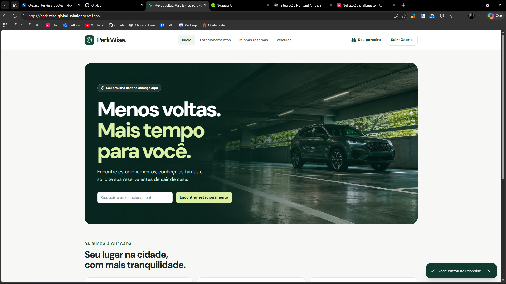
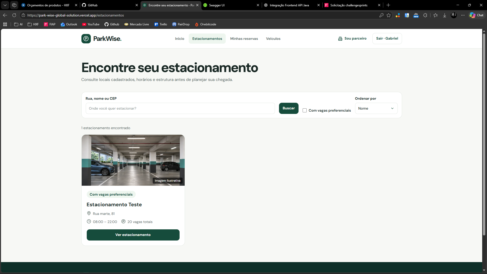
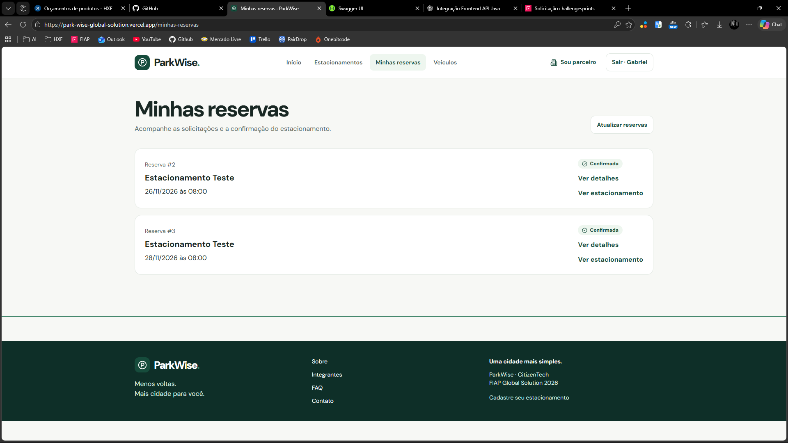
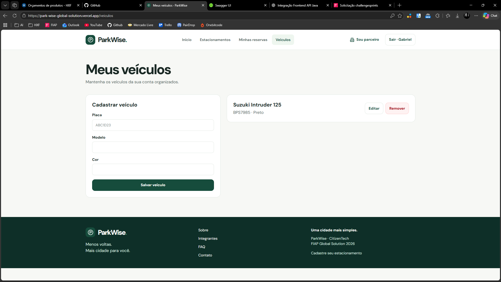
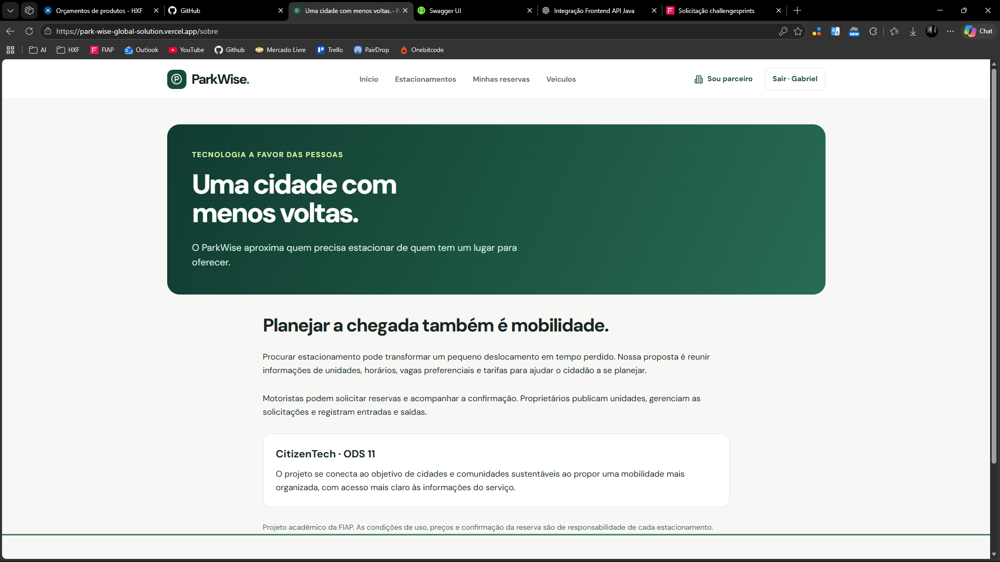
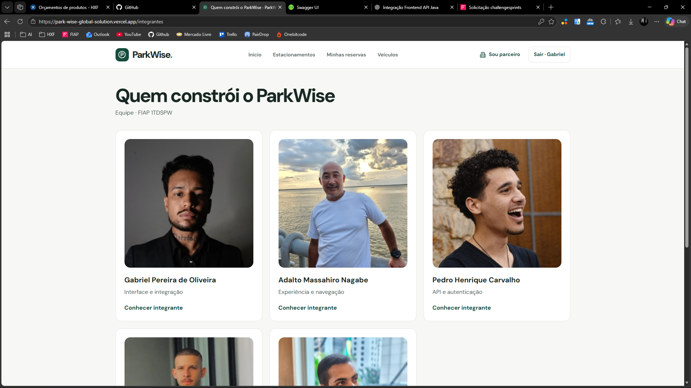
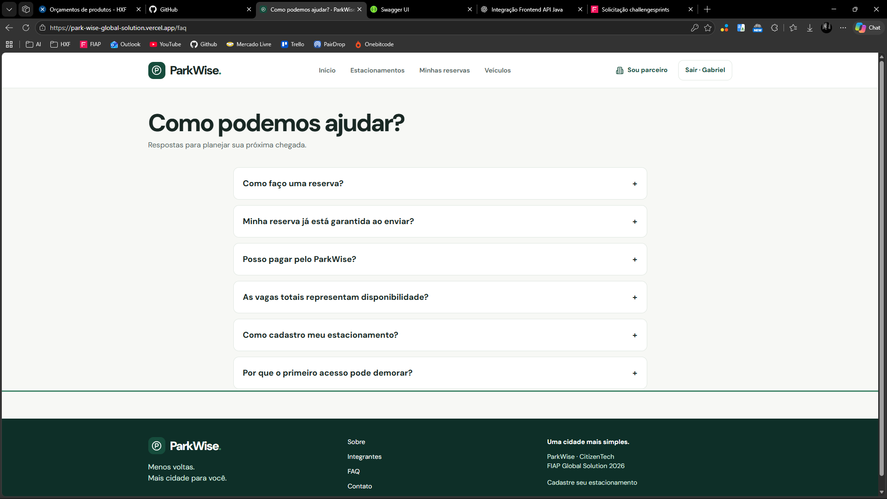
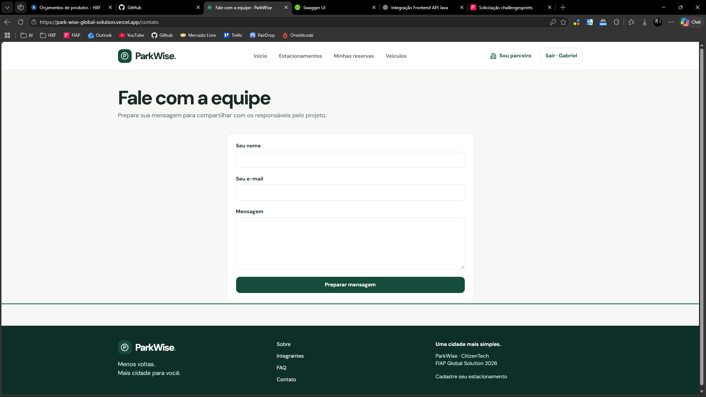

# ParkWise · Global Solution 2026/2

> Menos voltas. Mais tempo para você.

Aplicação web para conectar motoristas a estacionamentos, consultar informações das unidades e solicitar reservas antes de sair de casa. O projeto foi desenvolvido para a **Global Solution 2026/2 da FIAP**, no tema **CitizenTech**, com foco em mobilidade urbana e no ODS 11 — Cidades e comunidades sustentáveis.

O front-end utiliza **React, TypeScript, Vite e Tailwind CSS** e se integra à **API REST Java**, com autenticação JWT e persistência em banco Oracle pelo backend.

## Links do projeto

| Recurso                         | Endereço                                                                                                          |
| ------------------------------- | ----------------------------------------------------------------------------------------------------------------- |
| Aplicação publicada · Vercel    | [park-wise-global-solution.vercel.app](https://park-wise-global-solution.vercel.app/)                             |
| Repositório do front-end        | [Gabriel-Oliveira0611/ParkWise_GlobalSolution](https://github.com/Gabriel-Oliveira0611/ParkWise_GlobalSolution)   |
| Repositório da API Java         | [pedrohcnascimento/GerenciamentoEstacionamento](https://github.com/pedrohcnascimento/GerenciamentoEstacionamento) |
| URL base da API · Render        | [gerenciamentoestacionamento-ru6m.onrender.com](https://gerenciamentoestacionamento-ru6m.onrender.com)            |
| Documentação da API · Swagger   | [Abrir Swagger UI](https://gerenciamentoestacionamento-ru6m.onrender.com/swagger-ui/index.html)                   |
| Vídeo de demonstração · YouTube | [Assistir à demonstração do ParkWise](https://www.youtube.com/watch?v=RbgHhqo5kQ8)                                |

## Conteúdo

- [Objetivo](#objetivo)
- [Funcionalidades](#funcionalidades)
- [Tecnologias](#tecnologias)
- [Integrantes](#integrantes)
- [Como executar](#como-executar)
- [Configuração de ambiente](#configuração-de-ambiente)
- [Comandos disponíveis](#comandos-disponíveis)
- [Integração com a API Java](#integração-com-a-api-java)
- [Páginas e rotas](#páginas-e-rotas)
- [Estrutura do projeto](#estrutura-do-projeto)
- [Capturas de tela](#capturas-de-tela)
- [Vídeo de demonstração](#vídeo-de-demonstração)
- [Deploy na Vercel](#deploy-na-vercel)
- [Escopo e observações](#escopo-e-observações)
- [Uso de inteligência artificial](#uso-de-inteligência-artificial)

## Objetivo

Procurar estacionamento pode transformar um pequeno deslocamento em tempo perdido. O ParkWise reúne informações sobre endereço, horários de funcionamento, capacidade, vagas preferenciais e tarifas, ajudando o motorista a planejar sua chegada.

A solução também oferece uma área para o proprietário cadastrar suas unidades, gerenciar solicitações de reserva e registrar entradas e saídas. A proposta é facilitar o acesso às informações e contribuir para uma mobilidade urbana mais organizada.

## Funcionalidades

| Área                   | Funcionalidades                                                                                                    |
| ---------------------- | ------------------------------------------------------------------------------------------------------------------ |
| Consulta pública       | Busca de estacionamentos por texto, filtro de vagas preferenciais, ordenação e página de detalhes da unidade.      |
| Conta e autenticação   | Cadastro de motorista ou proprietário, login com JWT, restauração de sessão e navegação conforme o perfil.         |
| Motorista              | Cadastro, consulta, edição e remoção de veículos; solicitação e acompanhamento de reservas; envio de avaliações.   |
| Proprietário           | Cadastro, edição e remoção de unidades; gerenciamento de tarifas e reservas; registro de entradas e saídas.        |
| Páginas institucionais | Início, Sobre, Integrantes com fotos e detalhes individuais, FAQ e Contato.                                        |
| Interface              | Layout responsivo, menu mobile, validação de formulários e mensagens de carregamento, erro, sucesso e lista vazia. |

### Fluxo principal

1. O proprietário cria sua conta, cadastra um estacionamento e informa as tarifas.
2. O motorista cria sua conta e consulta as unidades disponíveis no catálogo.
3. Na página de detalhes, o motorista solicita uma reserva para uma data futura.
4. A solicitação aparece inicialmente como **Pendente** em **Minhas reservas**.
5. O proprietário confirma ou recusa a solicitação em sua área de gestão.
6. O motorista consulta a situação atualizada da reserva.

O cadastro de veículos é independente da reserva: o contrato atual da API não recebe o identificador do veículo na solicitação de reserva.

## Tecnologias

| Tecnologia                      | Utilização                                                   |
| ------------------------------- | ------------------------------------------------------------ |
| React 19                        | Construção da interface por componentes.                     |
| TypeScript 6                    | Tipagem dos componentes, serviços e contratos da API.        |
| Vite 8                          | Servidor de desenvolvimento e geração do build.              |
| Tailwind CSS 4                  | Estilização e responsividade.                                |
| React Router 7                  | Navegação da SPA, rotas dinâmicas e páginas por perfil.      |
| Fetch API                       | Requisições HTTP para a API Java.                            |
| Context API                     | Compartilhamento da sessão e das mensagens de feedback.      |
| JWT e sessionStorage            | Autenticação e manutenção da sessão no navegador.            |
| Lucide React e DM Sans          | Ícones e tipografia da interface.                            |
| Vitest, Testing Library e jsdom | Testes automatizados de interface, serviços e regras.        |
| Oxlint                          | Análise estática do código.                                  |
| Java, Spring Boot e Oracle      | API REST e persistência, mantidas no repositório do backend. |
| Vercel e Render                 | Hospedagem do front-end e da API, respectivamente.           |

As versões e dependências completas estão no [package.json](./package.json) e no [package-lock.json](./package-lock.json).

## Integrantes

**Curso:** Análise e Desenvolvimento de Sistemas · **Turma:** 1TDSPW · **Instituição:** FIAP

| Integrante                  | RM     | Área de atuação          |
| --------------------------- | ------ | ------------------------ |
| Gabriel Pereira de Oliveira | 572262 | Interface e integração.  |
| Adalto Massahiro Nagabe     | 572298 | Experiência e navegação. |
| Pedro Henrique Carvalho     | 570492 | API e autenticação.      |
| Murillo Siviero Lopes       | 572724 | Fluxos do motorista.     |
| Kauã Barros Ferreira        | 571801 | Gestão e validação.      |

A identificação da equipe também está em [integrantes.txt](./integrantes.txt). As fotos e as informações exibidas no site são configuradas em [src/config/equipe.ts](./src/config/equipe.ts), com imagens em `public/imagens/equipe/`.

## Como executar

### Pré-requisitos

- Git.
- Node.js e npm. Uma opção compatível é **Node.js 24.15 ou superior da linha 24**; consulte o campo `engines` do `package.json` para outras versões aceitas.
- Acesso à internet para instalar as dependências e utilizar a API remota.

### Instalação

```bash
git clone https://github.com/Gabriel-Oliveira0611/ParkWise_GlobalSolution.git
cd ParkWise_GlobalSolution
npm ci
npm run dev
```

Se o projeto já estiver no computador, abra um terminal na pasta que contém o `package.json` e execute apenas `npm ci` e `npm run dev`.

O Vite informa no terminal o endereço local da aplicação. A porta pode mudar se outra instância já estiver em execução.

### Build de produção

```bash
npm run build
npm run preview
```

O build é gerado na pasta `dist`. O comando `preview` permite visualizar essa versão localmente.

## Configuração de ambiente

A URL pública da API já está definida como padrão em [src/config/ambiente.ts](./src/config/ambiente.ts). Portanto, o projeto pode consultar a API sem um arquivo de ambiente adicional.

Para alterar o endereço do serviço ou configurar o contato, copie `.env.example` para `.env.local` e ajuste:

```dotenv
VITE_API_BASE_URL=https://gerenciamentoestacionamento-ru6m.onrender.com
VITE_CONTATO_EMAIL=
```

| Variável             | Finalidade                                                                                          |
| -------------------- | --------------------------------------------------------------------------------------------------- |
| `VITE_API_BASE_URL`  | URL base da API Java, sem acrescentar `/api/v1`.                                                    |
| `VITE_CONTATO_EMAIL` | E-mail opcional para abrir a mensagem preparada pelo formulário no aplicativo de e-mail do usuário. |

Reinicie o servidor de desenvolvimento após alterar essas variáveis. Na Vercel, alterações exigem um novo deploy.

Variáveis com prefixo `VITE_` são públicas no front-end. Credenciais do Oracle, chaves privadas e segredos do backend devem permanecer no servidor.

## Comandos disponíveis

| Comando              | Finalidade                                                       |
| -------------------- | ---------------------------------------------------------------- |
| `npm run dev`        | Iniciar o servidor de desenvolvimento.                           |
| `npm run build`      | Verificar TypeScript e gerar a versão de produção.               |
| `npm run preview`    | Visualizar o build localmente.                                   |
| `npm run typecheck`  | Executar a verificação de tipos.                                 |
| `npm run lint`       | Analisar o código com Oxlint.                                    |
| `npm test`           | Executar os testes isolados.                                     |
| `npm run test:watch` | Executar os testes em modo de acompanhamento.                    |
| `npm run check`      | Executar lint, testes isolados e build.                          |
| `npm run test:api`   | Executar o teste opcional de integração com escrita na API real. |

Para a verificação local completa:

```bash
npm run check
```

Os testes isolados utilizam respostas controladas para verificar contratos, validações, carregamento, sessão e tratamento de erros. A aplicação em uso consulta a API remota.

**O comando `npm run test:api` grava dados na API configurada.** Ele cria contas e registros próprios de teste, autentica os dois perfis, cria unidade, tarifa, veículo, reserva, movimentação e avaliação, relê os dados e tenta desativar os registros no bloco `finally`. Como a exclusão do backend é lógica, o histórico técnico permanece no Oracle. Esse teste não é executado pelo `npm test` normal.

## Integração com a API Java

Os serviços estão em `src/services/`. A comunicação utiliza JSON e envia o token JWT no cabeçalho `Authorization: Bearer <token>` nas operações autenticadas.

| Funcionalidade           | Endpoints utilizados                                                                                                           |
| ------------------------ | ------------------------------------------------------------------------------------------------------------------------------ |
| Cadastro e autenticação  | `POST /cliente`, `POST /dono`, `POST /auth/login`, `POST /auth/me`                                                             |
| Catálogo e detalhes      | `GET /estacionamento`, `GET /estacionamento/{id}`                                                                              |
| Veículos do motorista    | `GET /cliente/{id}/carros`, `POST /cliente/{id}/carros`, `PUT /carro/{id}`, `DELETE /carro/{id}`                               |
| Solicitação de reserva   | `POST /estacionamento/{id}/reservas`                                                                                           |
| Reservas do motorista    | `GET /cliente/{id}/reservas`                                                                                                   |
| Unidades do proprietário | `GET /dono/{id}/estacionamentos`, `POST /dono/{id}/estacionamentos`, `PUT /estacionamento/{id}`, `DELETE /estacionamento/{id}` |
| Gestão de reservas       | `GET /estacionamento/{id}/reservas`, `PUT /reserva/{id}`                                                                       |
| Tarifas                  | `GET /estacionamento/{id}/valores`, `POST /estacionamento/{id}/valores`, `DELETE /valor/{id}`                                  |
| Entradas e saídas        | `GET /estacionamento/{id}/acessos`, `POST /estacionamento/{id}/acessos`, `PUT /acesso/{id}`                                    |
| Avaliações               | `GET /estacionamento/{id}/avaliacoes`, `POST /estacionamento/{id}/avaliacoes`                                                  |

### Sessão e tratamento de erros

- O token é armazenado em `sessionStorage`, separado por endereço da API.
- Ao recarregar a aplicação, o perfil é validado por `POST /auth/me`.
- Respostas `401` invalidam a sessão e solicitam novo login.
- O front-end mantém os campos necessários do usuário e descarta o campo de senha que pode ser retornado no perfil pelo backend.
- A leitura do perfil no navegador organiza a navegação; a autorização das operações pertence à API.
- O cliente HTTP possui tempo limite de 90 segundos e oferece nova tentativa em caso de falha, sem repetir automaticamente operações de escrita.

O contrato consultado pelo projeto está em [docs/openapi.json](./docs/openapi.json). A documentação do serviço também pode ser acessada no [Swagger UI](https://gerenciamentoestacionamento-ru6m.onrender.com/swagger-ui/index.html).

## Páginas e rotas

| Rota                                        | Conteúdo                                                |
| ------------------------------------------- | ------------------------------------------------------- |
| `/`                                         | Página inicial e acesso à busca.                        |
| `/estacionamentos`                          | Catálogo, filtros e ordenação.                          |
| `/estacionamentos/:id`                      | Detalhes, tarifas, avaliações e solicitação de reserva. |
| `/entrar` e `/cadastro`                     | Login e criação de conta.                               |
| `/veiculos`                                 | Cadastro e gestão dos veículos do motorista.            |
| `/minhas-reservas` e `/minhas-reservas/:id` | Acompanhamento e detalhes das reservas.                 |
| `/parceiro`                                 | Área de unidades do proprietário.                       |
| `/parceiro/estacionamentos/novo`            | Cadastro de unidade.                                    |
| `/parceiro/estacionamentos/:id/editar`      | Edição de unidade.                                      |
| `/parceiro/:id/reservas`                    | Gestão das reservas da unidade.                         |
| `/parceiro/:id/tarifas`                     | Gestão de tarifas.                                      |
| `/parceiro/:id/acessos`                     | Registro de entradas e saídas.                          |
| `/sobre`                                    | Problema, proposta e relação com o tema CitizenTech.    |
| `/integrantes` e `/integrantes/:id`         | Equipe, fotos e informações individuais.                |
| `/faq`                                      | Perguntas frequentes.                                   |
| `/contato`                                  | Formulário com validação e preparação de mensagem.      |
| Demais caminhos                             | Página de rota não encontrada.                          |

## Estrutura do projeto

| Caminho             | Responsabilidade                                                         |
| ------------------- | ------------------------------------------------------------------------ |
| `public/imagens/`   | Imagens dos estacionamentos e fotos da equipe.                           |
| `src/components/`   | Componentes reutilizáveis, layout, formulários e proteção de acesso.     |
| `src/config/`       | Endereço da API e informações da equipe.                                 |
| `src/contexts/`     | Contextos de sessão e feedback.                                          |
| `src/pages/`        | Páginas institucionais, fluxo do motorista e área do proprietário.       |
| `src/services/`     | Cliente HTTP e serviços de autenticação, catálogo, motorista e parceiro. |
| `src/types/`        | Tipos e contratos da API.                                                |
| `src/utils/`        | Funções de formatação, datas e validação.                                |
| `src/test/`         | Testes automatizados e configuração do ambiente de testes.               |
| `scripts/`          | Execução do teste opcional com a API real.                               |
| `docs/openapi.json` | Contrato da API utilizado como referência.                               |
| `docs/imagens/`     | Capturas de tela apresentadas neste README.                              |
| `vercel.json`       | Configuração do framework e redirecionamento das rotas da SPA.           |

## Capturas de tela

As imagens abaixo registram a interface publicada na Vercel. Os dados exibidos correspondem ao momento das capturas e podem mudar conforme o uso da API.

### 1. Página inicial

Apresentação da proposta do ParkWise e acesso à busca de estacionamentos.



### 2. Estacionamentos

Catálogo com pesquisa, filtro de vagas preferenciais, ordenação e acesso aos detalhes da unidade.



### 3. Minhas reservas

Acompanhamento das solicitações e da situação retornada pela API.



### 4. Meus veículos

Formulário de cadastro e ações para editar ou remover os veículos da conta.



### 5. Sobre

Contextualização do problema de mobilidade, da solução e de sua relação com CitizenTech e o ODS 11.



### 6. Integrantes

Apresentação da equipe, com fotografias, áreas de atuação e acesso às informações individuais.



### 7. Perguntas frequentes

Respostas organizadas em seções expansíveis sobre reservas, capacidade, pagamentos e uso do sistema.



### 8. Contato

Formulário para validar os dados e preparar uma mensagem para a equipe.



## Vídeo de demonstração

[**Assistir ao vídeo do ParkWise no YouTube**](https://www.youtube.com/watch?v=RbgHhqo5kQ8)

Link direto: <https://www.youtube.com/watch?v=RbgHhqo5kQ8>.

## Deploy na Vercel

1. Importe o repositório do front-end na Vercel.
2. Selecione o framework **Vite**, o comando de build **`npm run build`** e o diretório de saída **`dist`**.
3. Caso utilize outra API, configure `VITE_API_BASE_URL` nas variáveis de ambiente do projeto.
4. Se desejar habilitar a abertura de e-mail no contato, configure `VITE_CONTATO_EMAIL`.
5. Publique o projeto e valide a navegação, o login e as operações de consulta e gravação.

O arquivo `vercel.json` encaminha as rotas da SPA para `index.html`, permitindo abrir diretamente páginas como `/estacionamentos` e `/integrantes`. O backend deve permitir a origem do front-end na configuração de CORS.

Aplicação publicada: [https://park-wise-global-solution.vercel.app/](https://park-wise-global-solution.vercel.app/).

## Escopo e observações

- **Reservas:** uma solicitação começa pendente e depende da confirmação do proprietário. O proprietário também pode recusar ou encerrar reservas conforme o fluxo da API.
- **Capacidade:** o número total de vagas representa a estrutura da unidade; não garante disponibilidade para uma data e um horário específicos.
- **Pagamentos:** valores e tarifas são informativos. Registros de entrada e saída não realizam cobrança financeira; o pagamento é combinado diretamente com o estacionamento.
- **Perfis:** o front-end oferece fluxos específicos para `CLIENTE` e `DONO`. Os perfis `GERENTE` e `ADMIN` existentes no backend não possuem painel dedicado nesta versão.
- **Cancelamento:** a interface do motorista acompanha as permissões do backend, que reserva a exclusão de reservas aos perfis operacionais.
- **Contato:** o formulário valida e prepara a mensagem. O envio é feito pelo usuário em seu canal de contato; configurar um e-mail habilita a abertura do aplicativo de e-mail.
- **Dados:** uma base vazia produz uma lista vazia real. Uma unidade cadastrada por um proprietário passa a alimentar o catálogo.
- **Imagens:** fotografias de substituição dos estacionamentos são identificadas na interface como ilustrativas.
- **Carregamento:** a primeira consulta ao serviço hospedado pode demorar. A interface informa o carregamento e oferece nova tentativa caso o tempo limite seja atingido.

## Uso de inteligência artificial

Foi utilizado ChatGPT/Codex como apoio à adaptação dos contratos da API, implementação, documentação, organização do roteiro e testes. A equipe é responsável por revisar o projeto, compreender seu funcionamento e explicar as contribuições e decisões técnicas na apresentação.

---

Projeto acadêmico · FIAP · Global Solution 2026/2 · CitizenTech · Turma 1TDSPW.
